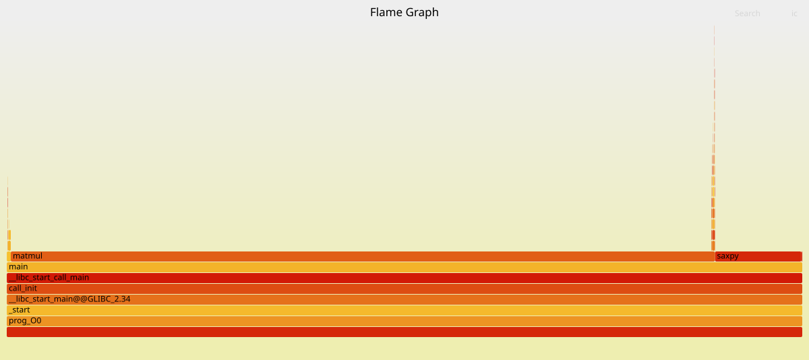
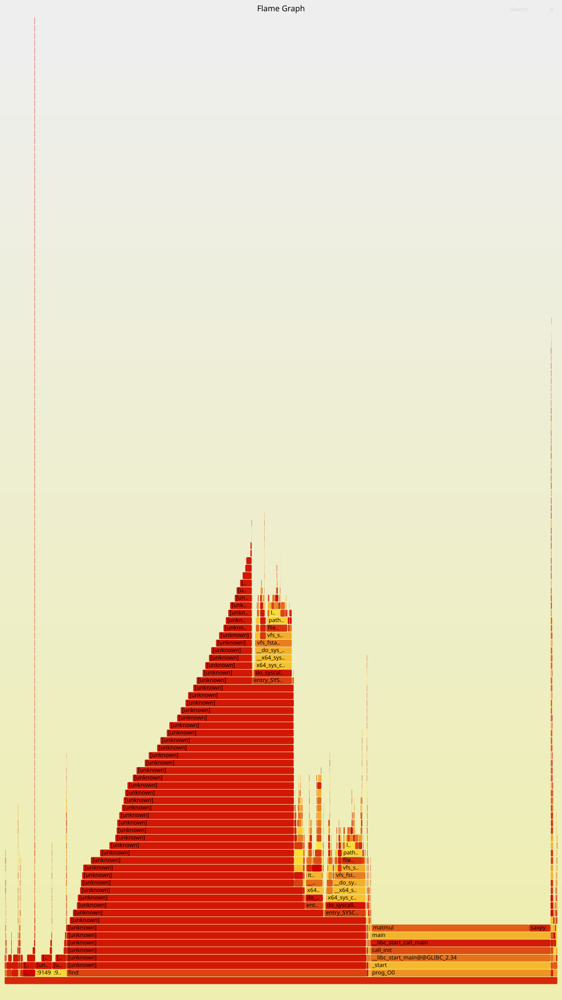
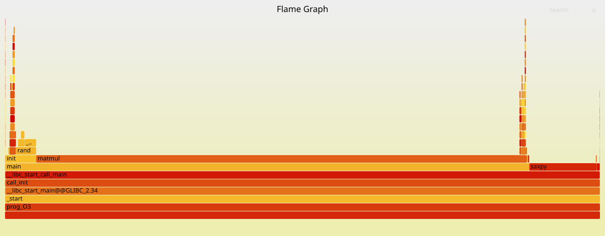
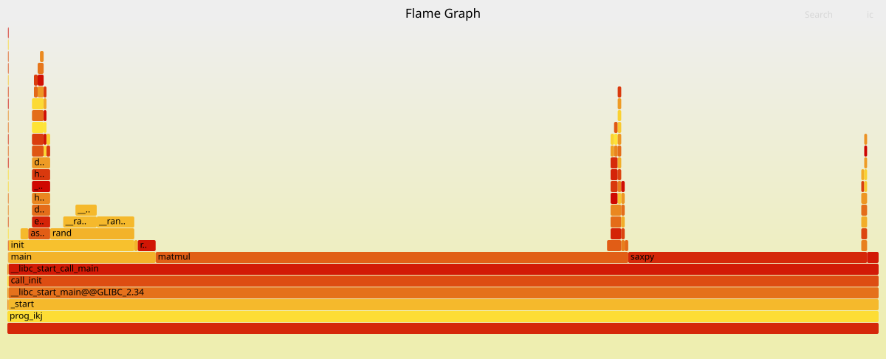
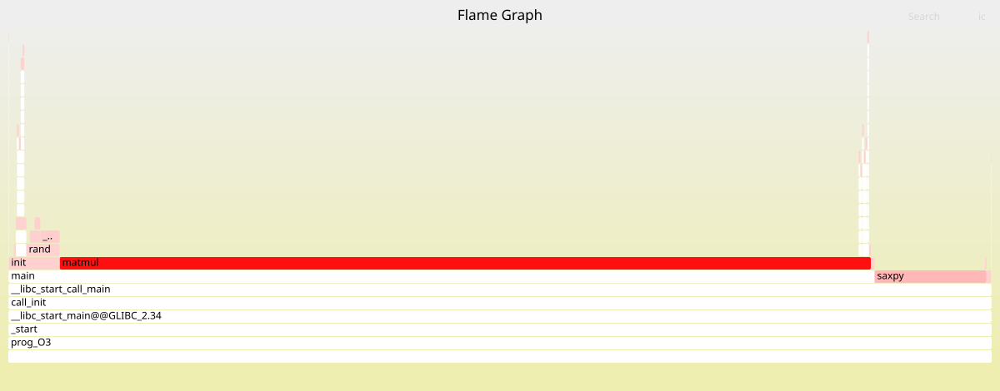

# Звіт: FlameGraph, perf, енергоспоживання, оптимізація

## Залізо

Робота виконана на ноутбуці з процесором **Intel Core i5-1145G7** (11-те покоління, Tiger Lake): 4 ядра / 8 потоків, частота 0.4–4.4 ГГц, кеш L1d 48 КБ на ядро, L2 1.25 МБ на ядро, L3 8 МБ спільний. Процесор підтримує AVX2, FMA і AVX-512, а також має лічильники енергії RAPL, тож усі пункти виконані на одній машині. ОС Ubuntu, компілятор GCC 15.2. Повний вивід `lscpu` є в [`results/cpu.txt`](results/cpu.txt).

## Досліджувана програма

[`prog.c`](prog.c) — невелика програма на C з чотирма функціями:

- `init()` заповнює випадковими числами матриці A, B (1024×1024 float, по 4 МБ) і вектори X, Y (2²⁰ float, по 4 МБ). Разом з матрицею C це 20 МБ, що більше за L3 (8 МБ).
- `matmul()` множить матриці C = A·B. Внутрішній цикл виконується N³ ≈ 1.07·10⁹ разів, тому це основне навантаження.
- `saxpy()` обчислює `Y = a·X + Y` і викликається 200 разів. Цикл простий і незалежний по ітераціях, тож це ідеальний кандидат для SIMD.
- `sum()` рахує суму всіх елементів, щоб компілятор не викинув обчислення як непотрібні.

Усі функції позначені `__attribute__((noinline))`, щоб навіть на `-O3` вони залишались окремими функціями і були видні на FlameGraph та в perf report.

Є три варіанти збірки ([`Makefile`](Makefile)):

```bash
gcc -O0 -g -fno-omit-frame-pointer prog.c -o prog_O0
gcc -O3 -march=native -g -fno-omit-frame-pointer prog.c -o prog_O3
gcc -O3 -march=native -DIKJ -g -fno-omit-frame-pointer prog.c -o prog_ikj
```

`prog_ikj` відрізняється від `prog_O3` лише порядком циклів у `matmul` (i-k-j замість i-j-k, перемикається через `-DIKJ`). Чому це важливо, видно далі.

Усе з цього звіту запускається скриптом [`run.sh`](run.sh), а всі сирі результати лежать у [`results/`](results).

---

## Пункт 1. FlameGraph

### 1.1 Побудова

Компілюємо з `-g -fno-omit-frame-pointer`. `-g` додає налагоджувальну інформацію, тому perf показує імена функцій і рядки коду. `-fno-omit-frame-pointer` залишає регістр `rbp` вказівником кадру стеку: `perf record -g` за замовчуванням розкручує стек саме по ланцюжку `rbp`. На `-O0` frame pointer є і так, а на `-O3` без цього ключа стеки на FlameGraph були б зламані.

Записуємо профіль виконання:

```bash
perf record -F 999 -g -o perf.data ./prog_O0
```

`-F 999` задає частоту семплування 999 Гц: perf 999 разів на секунду перериває програму і записує, яка інструкція виконувалась, разом з усім стеком викликів. Беруть 999, а не 1000, щоб семпли не збігалися з періодичними таймерами системи. `-g` записує стек викликів (call graph), без нього графік був би плоским.

Утворюється бінарний файл `perf.data`. Перетворюємо його в текст:

```bash
perf script -i perf.data > out.perf
```

Це сирий список усіх семплів. Скрипт `stackcollapse-perf.pl` згортає однакові стеки в один рядок з сумарною вагою:

```bash
./FlameGraph/stackcollapse-perf.pl out.perf > results/prog_O0.folded
```

Рядок виглядає так: `prog_O0;_start;__libc_start_main;main;matmul 15668...`. Із цього файлу будуємо графік:

```bash
./FlameGraph/flamegraph.pl results/prog_O0.folded > results/prog_O0.svg
```

Ці 4 кроки зібрані в [`flamegraph.sh`](flamegraph.sh): `./flamegraph.sh prog_O0`.

### 1.2 Отримані дані



Графік інтерактивний: по блоках можна клікати для збільшення, а Ctrl+F шукає функцію. Для цього треба відкрити SVG у браузері.

**Як читати графік:**
- по вертикалі відкладено глибину стеку: внизу `_start → __libc_start_main → main`, вище функції, які викликав `main`;
- по горизонталі відкладено частку семплів (тобто часу CPU), у яких функція була в стеку. Це **не** вісь часу: блоки відсортовані за абеткою;
- верхній край блоку, над яким нічого немає, означає, що CPU виконував код саме цієї функції.

**Результат (prog_O0):**

| Функція | Частка |
|---|---|
| matmul | 88.5% |
| saxpy | 10.9% |
| init (разом з `rand` з libc) | 0.5% |
| sum | 0.1% |

`matmul` займає майже всю ширину, і над нею нічого немає: весь час іде на сам цикл множення. Отже, оптимізувати треба передусім `matmul`. Пришвидшення `init` чи `sum` навіть у 10 разів загального часу майже не змінить (закон Амдала). Над `init` видно `rand → __random → __random_r`, тобто ця функція викликає бібліотечну libc.

**Вся система під час виконання** (`perf record -F 99 -a -g ./prog_O0`, ключ `-a` означає всі CPU):



| Процес | Частка |
|---|---|
| find | 54.2% |
| prog_O0 | 32.5% |
| процеси без імені (`:9149`, `:9150`, …) | ~10% |
| swapper (простій) | 0.7% |
| gnome-shell, ptyxis (термінал) | <1% |

Що видно:
- Під час заміру в системі паралельно працював процес `find` і зайняв навіть більше циклів, ніж наша програма. Його стеки складаються з `[unknown]`, бо `find` зібраний без frame pointer і без налагоджувальних символів, тому perf не може розкрутити його стек. Це гарна ілюстрація, навіщо ми збирали свою програму з `-fno-omit-frame-pointer`.
- Блоки з назвами `:9149` тощо — це короткоживучі потоки, ім'я яких perf не встиг визначити.
- `swapper` (idle-потік ядра) займає лише 0.7%, хоча більшість із 8 логічних CPU простоювала. Причина в тому, що perf семплує за подією `cycles`, а ядро у глибокому сні (C-state) тактів не рахує. Тому CPU FlameGraph показує, куди йдуть такти процесора, а не де минає реальний час.

---

## Пункт 2. Статистика

### 2.1 /usr/bin/time --verbose

```bash
/usr/bin/time --verbose ./prog_O0
```

```
	User time (seconds): 10.16
	System time (seconds): 0.01
	Percent of CPU this job got: 99%
	Elapsed (wall clock) time (h:mm:ss or m:ss): 0:10.18
	Maximum resident set size (kbytes): 22384
	Major (requiring I/O) page faults: 0
	Minor (reclaiming a frame) page faults: 5198
	Voluntary context switches: 1
	Involuntary context switches: 303
	Page size (bytes): 4096
	Exit status: 0
```

- **User time 10.16 с, System time 0.01 с.** Майже весь час припадає на режим користувача: програма обчислювальна (CPU-bound) і з ОС майже не взаємодіє.
- **Percent of CPU 99%.** Програма однопотокова і весь час займала одне ядро (на 8 потоках максимум був би 800%).
- **Maximum resident set size 22 384 КБ ≈ 21.9 МБ** — пікове використання RAM: 5 масивів по 4 МБ = 20 МБ, плюс код і libc.
- **Minor page faults 5198.** Масиви глобальні (секція `.bss`), і ОС виділяє фізичну сторінку лише при першому зверненні до неї: 20 МБ / 4 КБ = 5120 сторінок, що майже точно збігається. Major page faults 0, бо з диска нічого не читалося.
- **Voluntary context switches 1** (програма жодного разу сама не чекала на I/O). **Involuntary 303** — планувальник час від часу витісняв процес, щоб дати CPU іншим процесам.

### 2.2 perf stat -d

`perf stat` запускає програму і рахує апаратні події через лічильники продуктивності процесора. Ключ `-d` додає детальні події кешу.

```bash
perf stat -d ./prog_O0
```

```
               181      context-switches
                 0      cpu-migrations
             5,186      page-faults
         10,040.04 msec task-clock                       #      1.0 CPUs  CPUs_utilized
     1,114,762,536      L1-dcache-load-misses            #      9.7 %  l1d_miss_rate            (72.74%)
     1,067,042,977      LLC-loads                        #     11.6 %  llc_miss_rate            (63.65%)
         1,357,727      branch-misses                    #      0.1 %  branch_miss_rate         (54.56%)
     1,373,756,041      branches                         #    136.8 M/sec  branch_frequency     (54.56%)
    25,861,078,318      cpu-cycles                       #      2.6 GHz  cycles_frequency       (54.54%)
    31,710,136,800      instructions                     #      1.2 instructions  insn_per_cycle  (45.44%)
                        TopdownL1                        #     14.2 %  tma_backend_bound
                                                         #     74.1 %  tma_bad_speculation      (63.61%)
                                                         #      2.2 %  tma_frontend_bound       (63.63%)
                                                         #      9.5 %  tma_retiring             (72.72%)

      10.050208550 seconds time elapsed
```

- **task-clock 10 040 мс, 1.0 CPUs utilized** — як і в `time`, одне ядро завантажене повністю. `page-faults` 5186 збігаються з `time`.
- **cpu-cycles 25.9·10⁹, частота 2.6 ГГц.**
- **instructions 31.7·10⁹, IPC = 1.2** інструкції за такт. Ядро Tiger Lake може виконувати до 4–5 інструкцій за такт, тож це помірно. На одну ітерацію внутрішнього циклу `matmul` припадає ~25 інструкцій: так виглядає код `-O0` (див. п. 4.1).
- **branch-misses 0.1%** — цикли дуже передбачувані, передбачувач переходів майже не помиляється.
- **L1-dcache-load-misses 1.11·10⁹ і LLC-loads 1.07·10⁹.** Обидва числа майже дорівнюють N³ = 1.07·10⁹. Отже, практично на **кожній** ітерації внутрішнього циклу дані не знаходяться ні в L1, ні в L2, і запит іде в L3 (LLC). Причина: матриці зберігаються по рядках, `A[i][k]` читається підряд, а `B[k][j]` іде по стовпцю з кроком 1024·4 = 4096 Б. Кожне звернення до B потрапляє в нову кеш-лінію (64 Б), з якої використовується лише 4 Б. До того ж адреси з кроком 4 КБ потрапляють в один набір кешу, тож поки ми дійдемо до наступного `j`, лінії вже витіснені (конфліктні промахи).
- **llc_miss_rate 11.6%.** Більшість запитів до L3 влучає: матриця B (4 МБ) вміщається в L3 (8 МБ). Тому IPC тут 1.2, а не значно менше, як було б при постійному читанні з RAM.
- **Відсотки в дужках праворуч** (72%, 54%, 45%) — частка часу, коли подію реально рахували. Подій більше, ніж апаратних лічильників, тому perf вмикає їх по черзі (мультиплексує) і масштабує результат. Це оцінка.
- **TopdownL1** розкладає такти на категорії. Значення `bad_speculation` 74% суперечить `branch-misses` = 0.1%, тож тут ця метрика спотворена мультиплексуванням (вона рахувалась лише ~63% часу) і її не варто брати до уваги.

### 2.3 perf record + perf report

```bash
perf record -g ./prog_O0
perf report --stdio --no-children
```

Без `-F` perf семплує з частотою за замовчуванням 4000 Гц, тому семплів більше: 33K. `--stdio` дає текстовий вивід замість інтерактивного вікна, а `--no-children` показує «self»-час (час у тілі самої функції).

```
# Samples: 33K of event 'cpu/cycles/P'
# Event count (approx.): 22641338500
#
# Overhead  Command  Shared Object         Symbol
#
    90.63%  prog_O0  prog_O0               [.] matmul
            |
             --90.62%--matmul
                       main
                       __libc_start_call_main
                       __libc_start_main@@GLIBC_2.34
                       _start

     8.52%  prog_O0  prog_O0               [.] saxpy
            |
            ---saxpy
               main
               ...
     0.11%  prog_O0  libc.so.6             [.] __random
     0.08%  prog_O0  prog_O0               [.] sum
     0.08%  prog_O0  libc.so.6             [.] __random_r
     0.06%  prog_O0  prog_O0               [.] init
     0.04%  prog_O0  libc.so.6             [.] rand
     0.02%  prog_O0  [kernel.kallsyms]     [k] sync_regs
```

Кожен рядок — це функція певного бінарника чи бібліотеки (`Shared Object`). `[.]` позначає код користувача, `[k]` — код ядра. Під кожною функцією видно дерево викликів, тобто звідки її викликали: `_start → __libc_start_main → main → matmul`.

`matmul` займає 90.6% усього часу CPU, `saxpy` 8.5%, а `rand`/`__random` з libc і функції ядра (`sync_regs` — вхід у ядро при перериванні чи page fault) — соті частки відсотка. Це та сама картина, що й на FlameGraph, але в табличному вигляді. Відсотки трохи відрізняються від FlameGraph (90.6 проти 88.5), бо це окремий запуск з іншою частотою семплування.

Інтерактивно (`perf report` без `--stdio`) можна натиснути `a` на `matmul` і побачити анотований асемблер з відсотком семплів на кожній інструкції.

---

## Пункт 3. Енергоспоживання

Енергію вимірюємо через **RAPL** (Running Average Power Limit) — апаратні лічильники енергії, які процесор веде сам. Ядро Linux надає їх як подію perf `power/energy-pkg/`, тобто енергію всього пакета CPU (усі ядра, кеш L3, контролер пам'яті, вбудована графіка). RAPL рахує енергію для всього пакета, а не для окремого процесу, тому вимірюємо з ключем `-a` (уся система).

### 3.1 Вся система

Спочатку вимірюємо простій системи протягом 10 с:

```bash
perf stat -a -e power/energy-pkg/ sleep 10
```
```
             37.30 Joules power/energy-pkg/
      10.004200701 seconds time elapsed
```

P_idle = 37.30 Дж / 10.0 с ≈ **3.73 Вт** — потужність пакета CPU у простої (з фоновими процесами).

Тепер під час виконання програми:

```bash
perf stat -a -e power/energy-pkg/ ./prog_O0
```
```
            130.99 Joules power/energy-pkg/
      11.113619672 seconds time elapsed
```

За 11.11 с пакет CPU спожив 130.99 Дж, тобто середня потужність P = 130.99 / 11.11 ≈ **11.79 Вт**, що на ≈8 Вт більше, ніж у простої. Одне повністю завантажене ядро на частоті 2.5+ ГГц потребує саме стільки.

### 3.2 Тільки програма

RAPL не вміє виділити окремий процес, тому енергію самої програми оцінюємо, віднімаючи фон:

E_prog = E − P_idle · t = 130.99 − 3.73 · 11.11 = 130.99 − 41.44 ≈ **89.6 Дж**

Тобто з 131 Дж, спожитих пакетом, ≈41 Дж система витратила б і без програми, а ≈90 Дж (68%) — додаткова енергія через нашу програму.

Недоліки методу:
- припускається, що фон незмінний, а насправді будь-яка фонова активність потрапляє в результат (як `find` з п. 1.2);
- до «енергії програми» потрапляє і те, що процесор під навантаженням підвищує частоту та напругу для всього пакета.

Точніше можна було б виміряти, закріпивши програму за одним ядром (`taskset -c 2 ./prog_O0`) і скориставшись утилітами, які розподіляють енергію між процесами пропорційно до часу CPU (PowerJoular, Scaphandre).

---

## Пункт 4. Оптимізація

Оптимізація двох видів:
1. **ключами компілятора:** `-O0` → `-O3 -march=native` (`-march=native` дозволяє інструкції саме цього процесора: AVX2, FMA);
2. **зміною вихідного коду:** порядок циклів i-j-k → i-k-j у `matmul`:

```c
// i-j-k (prog_O0, prog_O3)            // i-k-j (prog_ikj, -DIKJ)
for (i) for (j) {                      for (i) for (k)
    float s = 0;                           for (j)
    for (k) s += A[i][k] * B[k][j];            C[i][j] += A[i][k] * B[k][j];
    C[i][j] = s;
}
```

У версії i-k-j у внутрішньому циклі по `j` значення `A[i][k]` є константою, а `B[k][j]` і `C[i][j]` читаються підряд (крок 4 Б). Кожна кеш-лінія використовується повністю (16 float), апаратний prefetcher встигає підвантажувати дані наперед, і ітерації незалежні, тож їх легко векторизувати.

### 4.1 Асемблерний код до і після оптимізації

Лістинги згенеровані командою `gcc -S -masm=intel` ([`prog_O0.s`](prog_O0.s), [`prog_O3.s`](prog_O3.s)). Для `prog_ikj` використано `objdump -d -M intel prog_ikj`.

**saxpy, -O0** (весь цикл):

```asm
.L17:
	mov	eax, DWORD PTR -4[rbp]        ; i зі стеку
	cdqe
	lea	rdx, 0[0+rax*4]               ; i*4
	lea	rax, X[rip]
	movss	xmm0, DWORD PTR [rdx+rax]     ; X[i] — один float
	movaps	xmm1, xmm0
	mulss	xmm1, DWORD PTR -20[rbp]      ; a*X[i], a теж зі стеку
	mov	eax, DWORD PTR -4[rbp]        ; знову i зі стеку
	cdqe
	lea	rdx, 0[0+rax*4]
	lea	rax, Y[rip]
	movss	xmm0, DWORD PTR [rdx+rax]     ; Y[i]
	addss	xmm0, xmm1
	mov	eax, DWORD PTR -4[rbp]        ; і втретє i
	cdqe
	lea	rdx, 0[0+rax*4]
	lea	rax, Y[rip]
	movss	DWORD PTR [rdx+rax], xmm0     ; Y[i] = ...
	add	DWORD PTR -4[rbp], 1          ; i++ прямо в пам'яті
.L16:
	cmp	DWORD PTR -4[rbp], 1048575
	jle	.L17
```

**saxpy, -O3 -march=native** (уся функція):

```asm
saxpy.constprop.0:
	lea	rax, Y[rip]
	vbroadcastss	ymm1, DWORD PTR .LC1[rip]   ; a=0.0001 → у всі 8 «доріжок» ymm1
	lea	rdx, X[rip]
	lea	rcx, 4194304[rax]                   ; кінець Y (4 МБ)
.L2:
	vmovaps	ymm0, YMMWORD PTR [rdx]             ; 8 елементів X
	add	rax, 32
	add	rdx, 32
	vfmadd213ps	ymm0, ymm1, YMMWORD PTR -32[rax]  ; ymm0 = a*X + Y для 8 елементів
	vmovaps	YMMWORD PTR -32[rax], ymm0          ; записати 8 Y
	cmp	rax, rcx
	jne	.L2
	vzeroupper
	ret
```

Що змінилося:
- **Змінні в регістрах.** На `-O0` лічильник `i` і `a` лежать у стеку (`-4[rbp]`, `-20[rbp]`), і на кожній ітерації їх читають з пам'яті та записують назад; `i` читається тричі. На `-O3` стек не використовується взагалі, навіть `push rbp` зник.
- **Індекс замінено вказівником.** Замість `i*4 + адреса масиву` вказівники `rax`, `rdx` просто збільшуються на 32 байти.
- **Векторизація.** Одна ітерація обробляє 8 float замість одного: 7 інструкцій на 8 елементів проти 21 інструкції на 1 елемент, тобто ~24 рази менше інструкцій.
- **FMA.** Множення і додавання злиті в одну інструкцію `vfmadd213ps`.
- **Розповсюдження констант.** Функція називається `saxpy.constprop.0`: GCC побачив, що `saxpy` завжди викликається з `a = 0.0001f`, і створив її копію, де `a` вшито як константу (`.LC1`), а не передається аргументом.
- **Немає «хвоста».** Довжина масиву (2²⁰) відома і кратна 8, а глобальні масиви вирівняні, тому не потрібен код для залишку, і використовуються вирівняні `vmovaps`.

**matmul i-j-k, -O0** — внутрішній цикл по k (25 інструкцій на 1 ітерацію):

```asm
.L12:
	mov	eax, DWORD PTR -4[rbp]       ; k
	cdqe
	mov	edx, DWORD PTR -16[rbp]      ; i
	movsxd	rdx, edx
	sal	rdx, 10                       ; i*1024 (зсув на 10 біт = множення на 1024)
	add	rax, rdx
	lea	rdx, 0[0+rax*4]
	lea	rax, A[rip]
	movss	xmm1, DWORD PTR [rdx+rax]    ; A[i][k]
	...                                   ; те саме для B[k][j]
	movss	xmm0, DWORD PTR [rdx+rax]    ; B[k][j]
	mulss	xmm0, xmm1
	movss	xmm1, DWORD PTR -8[rbp]      ; s зі стеку
	addss	xmm0, xmm1
	movss	DWORD PTR -8[rbp], xmm0      ; s у стек
	add	DWORD PTR -4[rbp], 1          ; k++
```

Усе як у `saxpy`: `i`, `j`, `k`, `s` лежать у стеку, індекс `i*1024+k` щоразу рахується заново. До того ж змінна `s` на кожній ітерації записується в пам'ять і одразу читається назад, і це створює ланцюжок залежностей через пам'ять.

**matmul i-j-k, -O3:**

```asm
.L18:
	mov	rax, rsi
	mov	rdx, r8
	vxorps	xmm0, xmm0, xmm0                    ; s[j..j+7] = 0
.L15:
	vbroadcastss	ymm1, DWORD PTR [rdx]       ; A[i][k] → 8 копій
	add	rax, 4096                            ; наступний рядок B (+4096 Б)
	add	rdx, 4                               ; наступний k
	vfmadd231ps	ymm0, ymm1, YMMWORD PTR -4096[rax]  ; s[j..j+7] += A[i][k]*B[k][j..j+7]
	cmp	rax, rcx
	jne	.L15
	add	rsi, 32
	vmovaps	YMMWORD PTR [rdi], ymm0             ; C[i][j..j+7] = s
```

GCC зробив **векторизацію зовнішнього циклу**: обробляє одразу 8 сусідніх `j`, тримаючи 8 сум в одному регістрі `ymm0`. Внутрішній цикл містить лише 6 інструкцій на 8 множень. Але доступ до B досі йде з кроком 4096 Б (`add rax, 4096`), тобто по стовпцю. Тому цей варіант упирається в пам'ять (IPC 0.6, п. 4.2).

**matmul i-k-j, -O3:**

```asm
	vbroadcastss ymm2,DWORD PTR [rdi]          ; A[i][k]
	vbroadcastss ymm1,DWORD PTR [rdi+0x4]      ; A[i][k+1]
	...
.L:	vmovaps     ymm0,YMMWORD PTR [rcx+rax*1]     ; B[k][j..j+7]
	vfmadd213ps ymm0,ymm2,YMMWORD PTR [rdx+rax*1]; A[i][k]*B[k][j..] + C[i][j..]
	vmovaps     YMMWORD PTR [rdx+rax*1],ymm0     ; → C[i][j..]
	vfmadd231ps ymm0,ymm1,YMMWORD PTR [rsi+rax*1]; += A[i][k+1]*B[k+1][j..]
	vmovaps     YMMWORD PTR [rdx+rax*1],ymm0     ; → C[i][j..]
	add    rax,0x20                              ; +32 Б, ПОСЛІДОВНО
	cmp    rax,0x1000
	jne    .L
```

Тепер усі звернення до пам'яті послідовні (`add rax, 0x20`). Крім того, компілятор розгорнув цикл по `k` на 2: за одну ітерацію обробляються 8 `j` × 2 `k` = 16 множень-додавань.

### 4.1.1 SIMD / AVX

SIMD (Single Instruction, Multiple Data) означає, що одна інструкція обробляє одразу кілька чисел, які лежать в одному широкому регістрі:

| Регістр | Ширина | float за раз | Розширення |
|---|---|---|---|
| `xmm` | 128 біт | 4 | SSE |
| `ymm` | 256 біт | 8 | AVX / AVX2 |
| `zmm` | 512 біт | 16 | AVX-512 |

Суфікси в назвах інструкцій: **`ss`** — scalar single (одне число float), **`ps`** — packed single (вектор float). На `-O0` у коді є лише `movss`, `mulss`, `addss`: регістр `xmm` використовується, але в ньому працює лише 1 число з 4 можливих. На `-O3` з'являються `ps`-інструкції на `ymm`.

Інструкції AVX, які трапляються в коді:
- **`vbroadcastss ymm1, [mem]`** — копіює одне число в усі 8 позицій регістра (константа `a` у `saxpy`, `A[i][k]` у `matmul`);
- **`vmovaps`** — завантажує або записує 8 float (32 Б) за раз; `a` означає aligned, тобто адреса має бути кратна 32;
- **`vfmadd213ps` / `vfmadd231ps`** — FMA (fused multiply-add) обчислює `a*b + c` для 8 пар чисел однією інструкцією з одним округленням. Цифри 213/231 вказують порядок операндів: які множаться, а до якого додається;
- **`vxorps xmm0, xmm0, xmm0`** — обнуляє регістр (x XOR x = 0);
- **`vzeroupper`** — обнуляє верхні половини `ymm` перед поверненням з функції, щоб не було штрафу при переході до старого SSE-коду;
- префікс **`v`** означає VEX-кодування (AVX), де інструкції мають 3 операнди і не перезаписують джерело.

`-march=native` дозволяє компілятору використовувати AVX2 і FMA, бо їх підтримує цей процесор. Без цього ключа `-O3` згенерував би лише SSE2 (`xmm`, 4 float, без FMA), бо це мінімальний набір для будь-якого x86-64.

Процесор підтримує й AVX-512 (`zmm`), але GCC для Tiger Lake за замовчуванням обирає 256-бітні регістри: на 512-бітних інструкціях частота процесора падає, і виграш часто невеликий. Увімкнути `zmm` можна ключем `-mprefer-vector-width=512`.

Цікавий побічний ефект: `sum` у трьох варіантах відрізняється в останніх знаках (`268899166.32…`). Векторизація змінює порядок додавань, FMA округлює один раз замість двох, а додавання float не асоціативне. Тож результат не неправильний, а лише трохи інший у межах похибки float.

### 4.2 Порівняння часу та показників

Дані з [`results/*_time.txt`](results) і [`results/*_stat.txt`](results):

| | O0 | O3 | ikj |
|---|---|---|---|
| Elapsed (`time`), с | 10.18 | 0.67 | 0.25 |
| Прискорення відносно O0 | 1× | 15.2× | 40.7× |
| User time, с | 10.16 | 0.65 | 0.23 |
| Max RSS, КБ | 22 384 | 22 392 | 22 392 |
| Minor page faults | 5198 | 5200 | 6223 |
| instructions | 31.7·10⁹ | 1.30·10⁹ | 1.02·10⁹ |
| cpu-cycles | 25.9·10⁹ | 2.16·10⁹ | 0.75·10⁹ |
| IPC | 1.2 | 0.6 | 1.4 |
| L1-dcache-load-misses | 1.11·10⁹ | 165·10⁶ | 96·10⁶ |
| LLC-loads | 1.07·10⁹ | 127·10⁶ | 12.8·10⁶ |
| branch-misses, % | 0.1 | 0.1 | 0.5 |

**O0 → O3** (лише ключі компілятора):
- Кількість інструкцій зменшилась у **24 рази**: одна векторна інструкція замінює 8 скалярних, а звертання до змінних у стеку зникли.
- Час зменшився в 15 разів, тобто менше, ніж кількість інструкцій. **IPC впав з 1.2 до 0.6**: інструкцій стало мало, і тепер вони здебільшого чекають даних з пам'яті. У `matmul` i-j-k доступ до B іде по стовпцю, тож кожна `vfmadd231ps` чекає на завантаження з L3. Тому IPC сам по собі не є мірою швидкості.
- LLC-loads зменшились з 1.07·10⁹ до 127·10⁶ ≈ N³/8. Тепер одне завантаження з B бере 8 float замість одного, але стовпцевий доступ залишився.

**O3 → ikj** (зміна коду):
- Інструкцій лише на 20% менше, а час менший у **2.7 раза**.
- LLC-loads зменшились **у 10 разів**: дані B і C читаються послідовно, кеш-лінії використовуються повністю, а prefetcher підвантажує наступні наперед.
- IPC зріс до 1.4: процесор менше чекає пам'ять.
- Тобто ключі компілятора прибрали «зайві» інструкції, а зміна порядку циклів прибрала очікування пам'яті.

**Що не змінилось:** Max RSS (≈22 МБ), бо масиви ті самі. Minor page faults у `prog_ikj` більші на ~1000 (= 4 МБ / 4 КБ, тобто одна матриця). Це матриця C: у версії i-k-j вона спершу **читається** (`C[i][j] += …`), і ядро відображає на неї спільну нульову сторінку. Потім при **записі** стається другий fault, щоб виділити реальну сторінку. У версії i-j-k у C лише пишуть, тож fault один.

**Зауваження про точність:** `perf stat` для O3 показав 1.12 с і частоту 1.9 ГГц, а `time` — 0.67 с. Ноутбук динамічно змінює частоту (турбо-буст, енергозбереження, температура), тому для короткої програми розкид між запусками помітний. Для точнішого порівняння варто повторювати заміри (`perf stat -r 5`) і фіксувати частоту (`cpupower frequency-set -g performance`). Співвідношення між варіантами від цього не змінюється.

### 4.3 FlameGraph після оптимізації

| O0 | O3 | ikj |
|---|---|---|
|  |  |  |

| Функція | O0 | O3 | ikj |
|---|---|---|---|
| matmul | 88.5% | 82.5% | 54.2% |
| saxpy | 10.9% | 11.4% | 27.4% |
| init (+ rand) | 0.5% | 5.2% | 14.4% |
| sum | 0.1% | 0.5% | 1.3% |

FlameGraph нормує все до 100% ширини, тож показує частки, а не абсолютний час. Якщо перемножити частку на загальний час, видно, що відбулося:

| Функція, с | O0 | O3 | ikj |
|---|---|---|---|
| matmul | 9.01 | 0.55 | 0.14 |
| saxpy | 1.11 | 0.08 | 0.07 |
| init | 0.05 | 0.04 | 0.04 |

- `matmul` пришвидшилась у 16 разів на O3 і в 66 разів на ikj, тому її блок звужується.
- `saxpy` на O3 пришвидшилась у 14 разів (векторизація), але ikj на неї не впливає. Тому на ikj її частка зросла до 27%.
- `init` майже не змінилась (~0.04 с), бо більшість її часу йде на `rand()` з libc, яку ми не перекомпільовували. Тому на ikj вона вже займає 14% графіка. Це закон Амдала в дії: після оптимізації головного «вузького місця» стають помітними частини, які раніше були непомітні.
- Назва `saxpy.constprop.0` на O3 замість `saxpy` — це та сама клонована копія з константою `a`, про яку йшлося в п. 4.1.

**Диференційний FlameGraph O0 → O3** (`difffolded.pl -n` нормує обидва профілі). Синім позначено функції, частка яких зменшилась, червоним — ті, частка яких зросла:



```bash
./FlameGraph/difffolded.pl -n results/prog_O0.folded results/prog_O3.folded | ./FlameGraph/flamegraph.pl > results/diff.svg
```

### 4.4 Енергоспоживання після оптимізації

P_idle = 3.73 Вт (п. 3.1), E_prog = E − P_idle · t.

| | O0 | O3 | ikj |
|---|---|---|---|
| E системи (pkg), Дж | 130.99 | 8.10 | 3.57 |
| t, с | 11.11 | 0.61 | 0.26 |
| P = E / t, Вт | 11.79 | 13.33 | 13.53 |
| E лише програми, Дж | 89.6 | 5.8 | 2.6 |
| Економія енергії програми | 1× | 15.3× | 34.6× |

- **Енергія зменшилась майже пропорційно часу:** 15× для O3 і 35× для ikj. За формулою E = P · t, якщо програма працює в 15 разів менше, а потужність приблизно та сама, енергії теж потрібно в ~15 разів менше.
- **Потужність трохи зросла** (11.8 → 13.3–13.5 Вт), з двох причин:
  1. AVX/FMA-блоки, які на O0 простоювали, тепер працюють на кожному такті, а широкі векторні операції споживають більше енергії за такт;
  2. ймовірно, також впливає турбо-буст: коротка програма (0.3–0.6 с) повністю вкладається в короткочасний ліміт потужності процесора, а довга O0 (11 с) встигає впертися в довготривалий ліміт, після чого процесор знижує частоту й напругу. З нашими даними цього не перевірити, бо частота між запусками коливалась (див. зауваження в п. 4.2).
- **Менше інструкцій та звертань до пам'яті** означає, що на виконання тієї самої роботи йде менше енергії: не треба витягувати, декодувати й виконувати 30 млрд «зайвих» інструкцій і 1 млрд разів ходити в L3.
- Це принцип **race-to-idle**: вигідніше швидко виконати роботу на повній потужності і перевести процесор у сон, ніж довго працювати на меншій.

---

## Висновки

1. FlameGraph і `perf report` показали, що 88–90% часу програма проводить у `matmul`, тож саме її і треба оптимізувати.
2. `perf stat` показав причину: на кожній ітерації внутрішнього циклу є промах L1/L2 (1.07·10⁹ ≈ N³ звертань до L3) через доступ до матриці B по стовпцю.
3. Ключі `-O3 -march=native` прибрали роботу зі стеком і векторизували цикли (AVX2 `ymm`, FMA). Інструкцій стало в 24 рази менше, програма пришвидшилась у 15 разів.
4. Перестановка циклів i-k-j зробила доступ до пам'яті послідовним: звертань до L3 стало в 10 разів менше, загальне пришвидшення досягло 41×.
5. Енергоспоживання програми зменшилось у 15× та 35× відповідно, майже пропорційно часу, хоча середня потужність трохи зросла.
6. Після оптимізації вузьке місце змістилось: на FlameGraph стали помітними `saxpy` і `init` (`rand()` з libc), які раніше займали частки відсотка.
